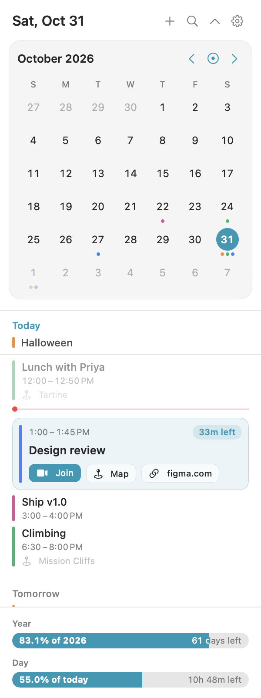
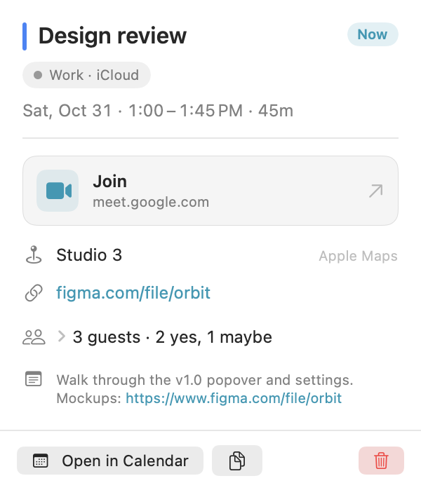

<p align="center">
  
</p>
<p align="center">
  <a href="https://github.com/janakjobanputra/orbit/releases/latest"></a>
  
  
  <a href="LICENSE"></a>
</p>

# Orbit

Your whole day, one click away in the menu bar. [try-orbit.app](https://try-orbit.app)

Native Swift, a few MB, reads your Mac calendar. No account, no subscription, no Electron, and your calendar never leaves your Mac (the only thing it fetches is a once-a-day check on GitHub for a new version, which you can turn off). I built this because I wanted my next meeting and my week a click away, without paying monthly for a calendar app or signing into yet another service.

## Install

[Download Orbit](https://try-orbit.app/download), open the disk image, and drag Orbit into Applications. It's signed and notarized, so it opens like any other app.

Or with [Homebrew](https://brew.sh):

```bash
brew install --cask janakjobanputra/tap/orbit-calendar
```

## Screenshots

<p>
  
  
</p>

## What it does

The menu bar shows the date, the time, or your next meeting. Click it and you get your month and the days ahead.

- Agenda of the days ahead. Each day's all-day events stay pinned at the top while you scroll through it.
- The meeting you're in, or the one starting in the next 10 minutes, expands with Join, Map and link buttons.
- Click any event for its details: calendar, video link, location, links, guests and notes. Open it in Calendar, copy it, or delete it.
- One-click join for Zoom, Meet, Teams, Webex and more, plus any video service you add.
- Finished events step aside, so the next thing on your day is always at the top.
- Year and day progress bars, week numbers, free-time gaps and a day summary, each optional.
- A Settings window with a live preview of the calendar, so you see every change as you make it.
- Tells you when a new version is out, with a Download button right in the calendar.
- Keyboard shortcuts: `⇧⌘C` to open the calendar and `⇧⌘J` to join your next meeting from anywhere, `⌘N` for a new event, `⌘F` to search, `Esc` to step back out.

## Requirements

macOS 26 or later. It will ask for calendar access on first launch.

## Build from source

```bash
brew install xcodegen
git clone https://github.com/janakjobanputra/orbit.git
cd orbit
make build
```

App ends up in `build/Build/Products/Debug/Orbit.app`. `make test` runs the tests, and [docs/RELEASING.md](docs/RELEASING.md) covers building the signed DMG and TestFlight uploads.

## License

GPL-3.0
