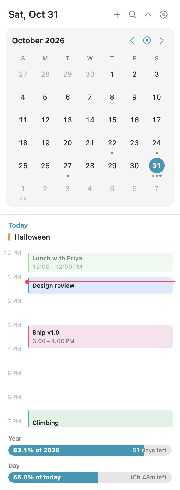
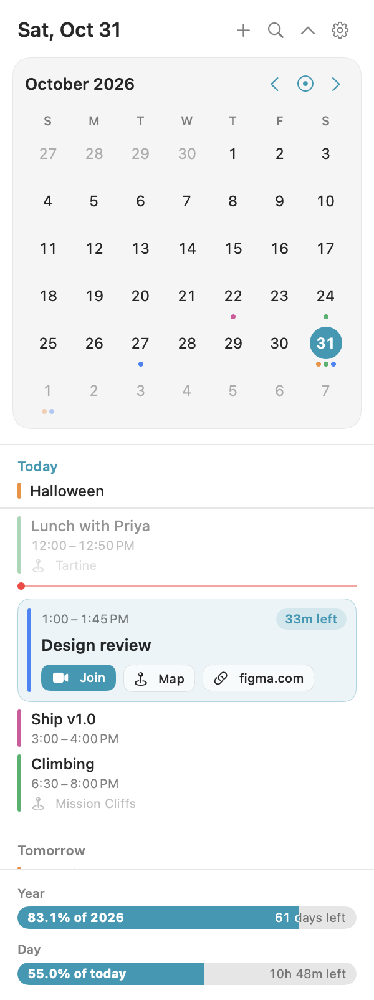

<p align="center">
  
</p>
<p align="center">
  <a href="https://github.com/janakjobanputra/orbit/releases/latest"></a>
  
  
  <a href="LICENSE"></a>
</p>

# Orbit

Your whole day, one click away in the menu bar. [try-orbit.app](https://try-orbit.app)

Native Swift, a few MB, reads your Mac calendar. No account, no subscription, no Electron, and your calendar never leaves your Mac. It does use the network for three things, each of which you can turn off: a once-a-day check for a new version, crash reports (on by default), and anonymous usage stats (off unless you turn them on). I built this because I wanted my next meeting and my week a click away, without paying monthly for a calendar app or signing into yet another service.

## Install

[Download Orbit](https://try-orbit.app/download), open the disk image, and drag Orbit into Applications. It's signed and notarized, so it opens like any other app.

Or with [Homebrew](https://brew.sh):

```bash
brew install --cask janakjobanputra/tap/orbit-calendar
```

## Screenshots

<p>
  <picture>
    <source media="(prefers-color-scheme: dark)" srcset="docs/images/day-dark.png">
    
  </picture>
  <picture>
    <source media="(prefers-color-scheme: dark)" srcset="docs/images/agenda-dark.png">
    
  </picture>
  <picture>
    <source media="(prefers-color-scheme: dark)" srcset="docs/images/detail-dark.png">
    
  </picture>
</p>

## What it does

The menu bar shows the date, the time, your next meeting, or just Orbit's logo. Click it and you get your month and the days ahead.

- A Day view of today (or any date you pick) hour by hour, like Calendar, with overlapping meetings side by side and a line at the current time.
- The whole month above it, or a rolling 3 weeks with this week in the middle.
- Or, set in Settings, an agenda of the days ahead. Each day's all-day events stay pinned at the top while you scroll through it.
- The meeting you're in, or the one starting in the next 10 minutes, expands with Join, Map and link buttons.
- A minute before each video call, an alert with Join (and Granola, if you use it for notes). Join opens Zoom and Teams calls straight in their apps.
- Click any event for its details: calendar, video link, location, links, guests and notes. Open it in Calendar, copy it, or delete it.
- One-click join for Zoom, Meet, Teams, Webex and more, plus any video service you add.
- Finished events step aside, so the next thing on your day is always at the top.
- Year and day progress bars, week numbers, free-time gaps and a day summary, each optional.
- A Settings window with a live preview of the calendar, so you see every change as you make it.
- A short welcome tour on first launch that sets up calendar access, your view and the menu bar.
- Updates itself: when a new version is out it shows the release notes, then installs and relaunches in a click.
- Keyboard shortcuts: `⇧⌘C` to open the calendar and `⇧⌘J` to join your next meeting from anywhere, `⌘N` for a new event, `⌘F` to search, `Esc` to step back out.

## Requirements

macOS 15 Sequoia or later. The welcome tour asks for calendar access on first launch.

## Build from source

```bash
brew install xcodegen
git clone https://github.com/janakjobanputra/orbit.git
cd orbit
make build
```

App ends up in `build/Build/Products/Debug/Orbit.app`. `make test` runs the tests, and [docs/RELEASING.md](docs/RELEASING.md) covers building the signed DMG and TestFlight uploads.

## License

GPL-3.0
